<div align="center">


### A feira do bairro, agora no celular 🥑

Loja online do **Verdurão Piuminas**, em Piúma (ES): frutas, verduras, legumes, queijos e bebidas com entrega em casa.

<br>


[Sobre](#sobre-o-projeto) ·
[Funcionalidades](#funcionalidades) ·
[Telas](#telas) ·
[Stack](#stack) ·
[Arquitetura](#arquitetura) ·
[Rodar localmente](#como-rodar-localmente) ·
[Deploy](#deploy-no-ubuntu-server) ·
[Roadmap](#roadmap)

<br>

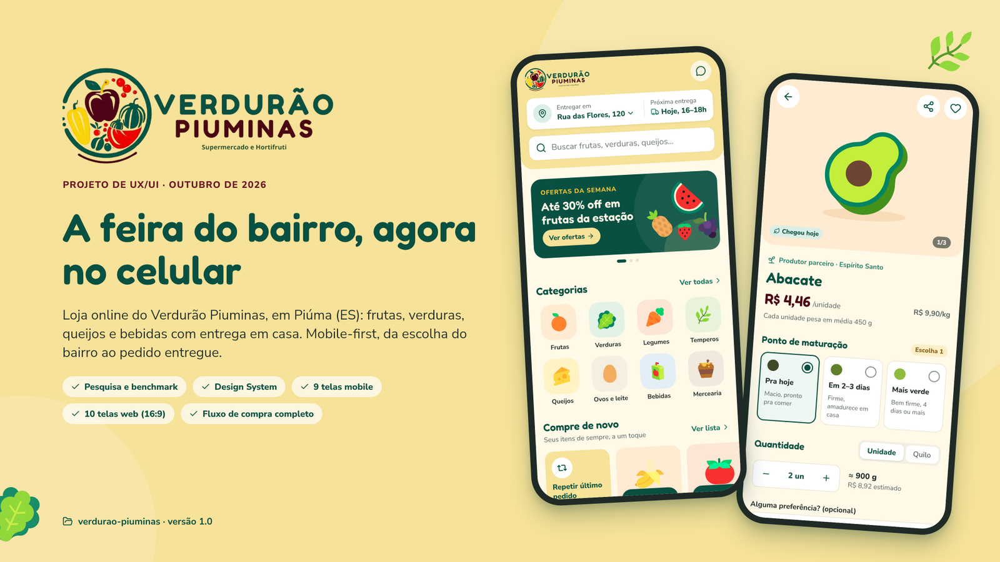

</div>

---

## Sobre o projeto

O Verdurão Piuminas é um supermercado e hortifrúti de **Piúma, no litoral sul do Espírito Santo**. Este projeto leva a loja para a internet com um site **mobile-first** de compras com entrega a domicílio.

A experiência foi pensada para quem compra hortifrúti toda semana e quer **escolher a fruta como na feira**. Também leva em conta a realidade da cidade: **Piúma inteira usa o mesmo CEP (29285-000)**. Por isso a entrega é organizada **por bairro**, e o endereço usa **ponto de referência**, que é o que o entregador realmente usa.

> **Fase atual:** pesquisa, design system e telas (mobile e web) concluídos. Próximo passo: definir a integração com o banco e começar o código.

## Funcionalidades

| | Funcionalidade | Como funciona |
|:-:|---|---|
| 🥑 | **Ponto de maturação** | O cliente escolhe se quer a fruta *pra hoje*, *em 2–3 dias* ou *mais verde*. |
| ⚖️ | **Peso variável com preço justo** | Compra por unidade (peso aproximado) ou por quilo. O valor final segue o peso real, e se ficar mais barato a diferença volta. |
| 📍 | **Entrega por bairro** | Taxa e próximo horário por bairro. Endereço com ponto de referência. Interior (Aghá, Orobó…) combinado pelo WhatsApp. |
| 🕓 | **Janelas de entrega** | Dia e faixa de 2 horas, com vagas em tempo real. Janelas esgotadas aparecem riscadas. |
| 🔁 | **Compre de novo** | Itens de sempre e "Repetir último pedido" logo na home. |
| 🔄 | **Se faltar algum item** | Uma preferência para o pedido todo: trocar por um parecido, chamar no WhatsApp ou não trocar. |
| 💸 | **Pagamento** | Pix, cartão de crédito online ou pagamento na entrega (maquininha ou dinheiro com troco). |
| 💬 | **WhatsApp** | Avisos de cada etapa do pedido e atendimento humano a um toque. |
| 📦 | **Acompanhamento** | Linha do tempo do pedido, trocas de item e ajuste de peso avisados com opção de desfazer. |
| 🌱 | **Da roça capixaba** | Vitrine de produtores do Espírito Santo. |

## Telas

### Mobile (390 px)

<table>
  <tr>
    <td align="center">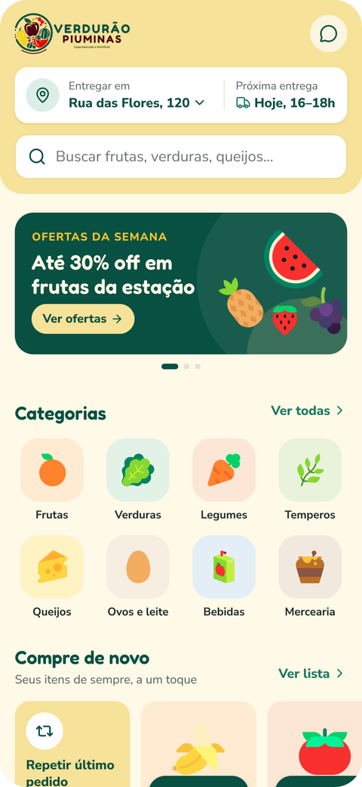<br><sub><b>Home</b></sub></td>
    <td align="center">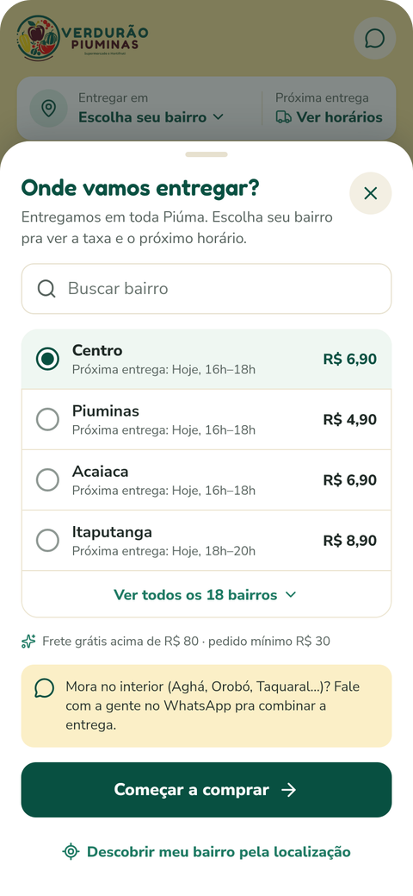<br><sub><b>Área de entrega por bairro</b></sub></td>
    <td align="center">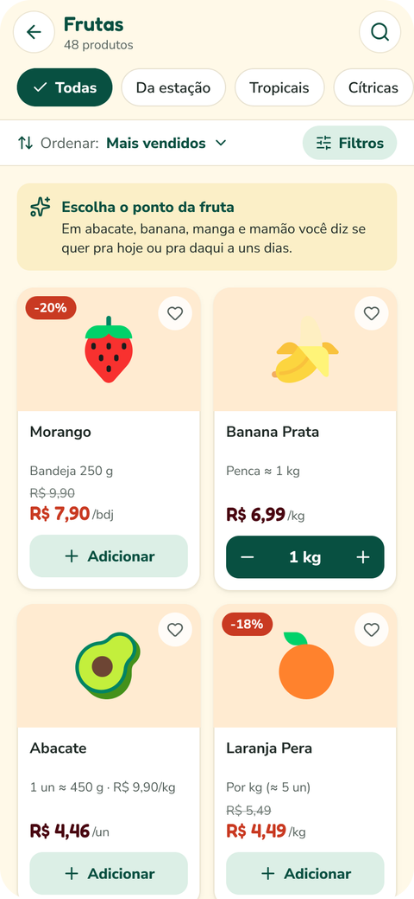<br><sub><b>Categoria</b></sub></td>
  </tr>
  <tr>
    <td align="center">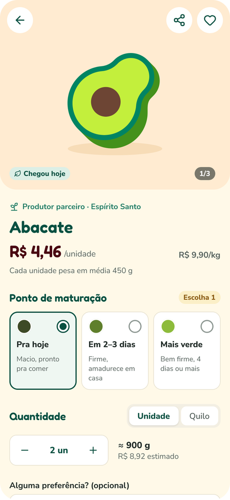<br><sub><b>Produto e ponto da fruta</b></sub></td>
    <td align="center">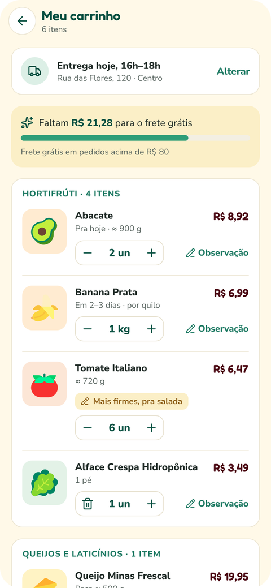<br><sub><b>Carrinho</b></sub></td>
    <td align="center">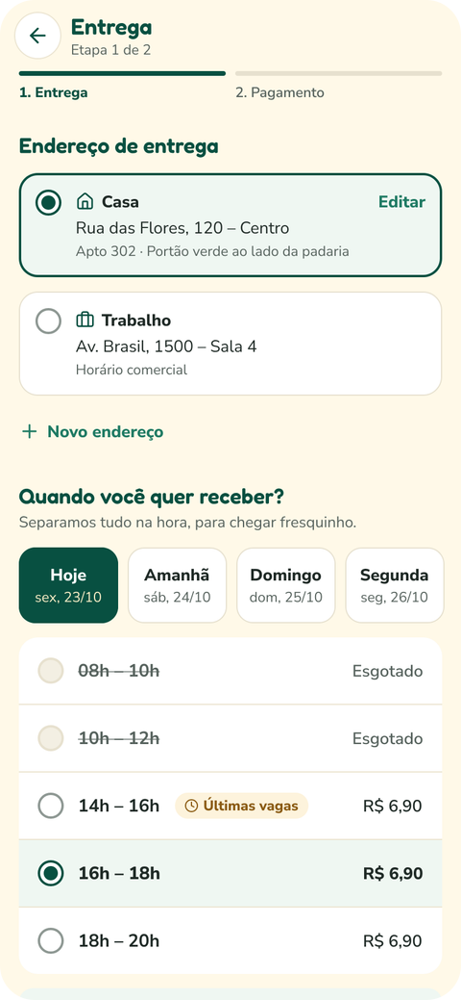<br><sub><b>Checkout: entrega</b></sub></td>
  </tr>
  <tr>
    <td align="center">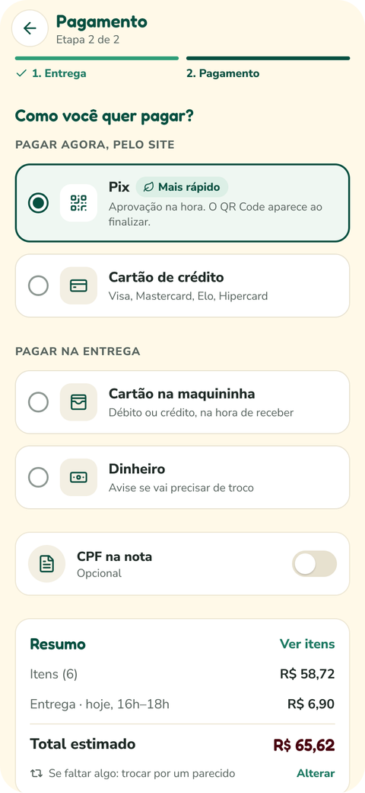<br><sub><b>Checkout: pagamento</b></sub></td>
    <td align="center"><br><sub><b>Pagamento com Pix</b></sub></td>
    <td align="center">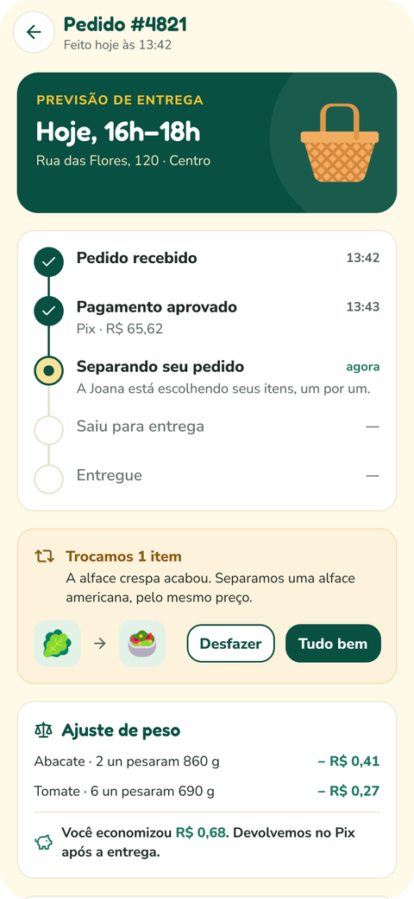<br><sub><b>Acompanhar pedido</b></sub></td>
  </tr>
</table>

### Web (1920 × 1080, 16:9)

<table>
  <tr>
    <td align="center">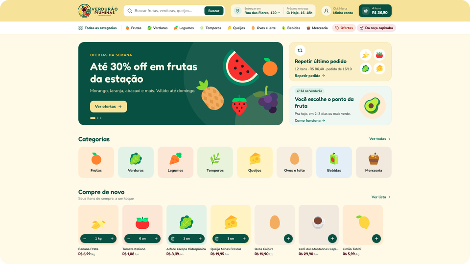<br><sub><b>Home</b></sub></td>
    <td align="center">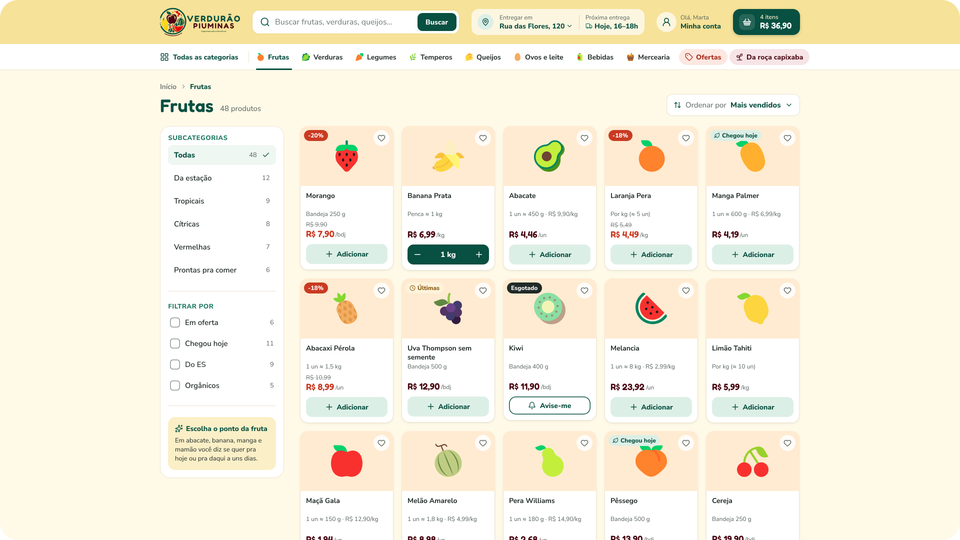<br><sub><b>Categoria com filtros na lateral</b></sub></td>
  </tr>
  <tr>
    <td align="center">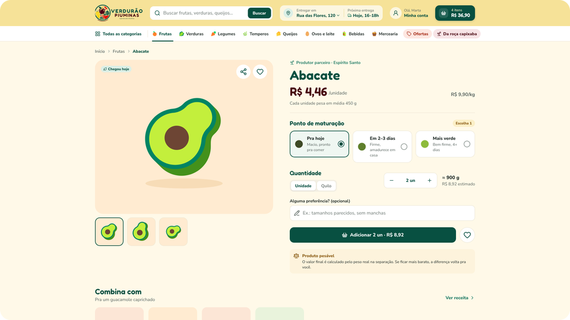<br><sub><b>Produto</b></sub></td>
    <td align="center">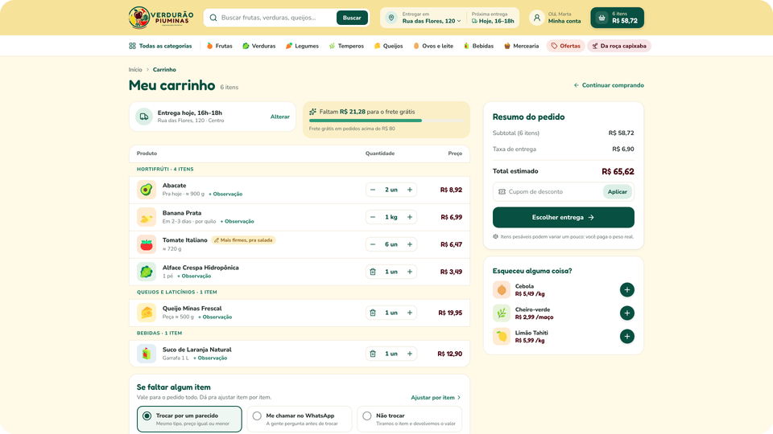<br><sub><b>Carrinho</b></sub></td>
  </tr>
  <tr>
    <td align="center">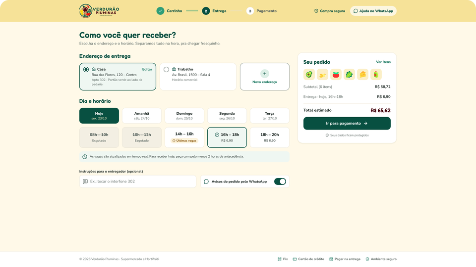<br><sub><b>Checkout: entrega</b></sub></td>
    <td align="center">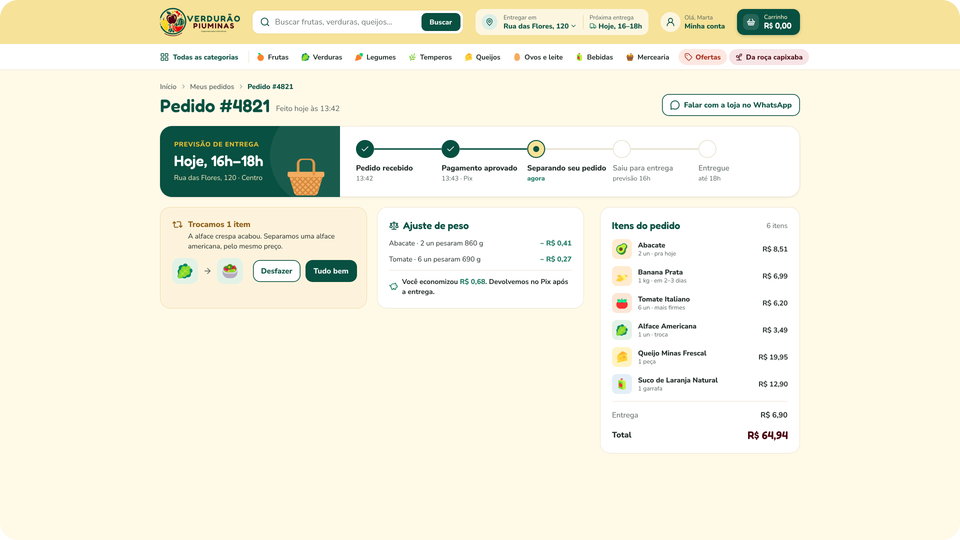<br><sub><b>Acompanhar pedido</b></sub></td>
  </tr>
</table>

Todas as telas, em tamanho real, estão em [`design/exports/`](design/exports/). O arquivo editável fica em [`design/`](design/).

### Identidade visual


Tipografia: **Fredoka** (títulos e preços) e **Nunito Sans** (textos). As cores e medidas estão prontas como variáveis CSS em [`docs/tokens.css`](docs/tokens.css).

## Stack

| Camada | Tecnologia | Status |
|---|---|:-:|
| Frontend | **Angular 22** + TypeScript 6.0 (lançado em jun/2026, com suporte até jun/2028) | ✅ definido |
| Ferramentas do frontend | **Node.js 24 LTS** (o Node.js 26 vira LTS em 28/10/2026) | ✅ definido |
| Backend | **Java 25 LTS** (OpenJDK 25) · API REST | ✅ definido |
| Framework da API | Spring Boot 4 (suporta Java 25) | 🟡 sugestão |
| Banco de dados | **PostgreSQL 18** (versão incluída no Ubuntu 26.04) | ✅ definido |
| Integração com o banco | JPA/Hibernate, JdbcClient, jOOQ ou MyBatis ([comparativo](#decisões-em-aberto)) | 🟡 a definir |
| Migrações do banco | Flyway | 🟡 sugestão |
| Servidor | **Ubuntu Server 26.04 LTS** | ✅ definido |
| Proxy e HTTPS | Nginx + Let's Encrypt (Certbot) | 🟡 sugestão |
| Pagamentos | Gateway com Pix e cartão (Mercado Pago, Asaas, PagBank…) | 🟡 a definir |
| Notificações | WhatsApp Business API (avisos de pedido) | 🟡 a definir |

## Arquitetura

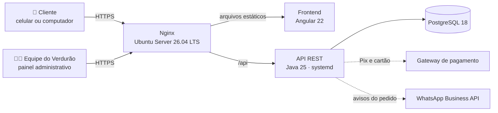

Tudo roda em um único servidor Ubuntu: o Nginx entrega o Angular já compilado e repassa `/api` para a aplicação Java, que roda como serviço do `systemd` e conversa com o PostgreSQL local.

### Modelo inicial de dados (rascunho)

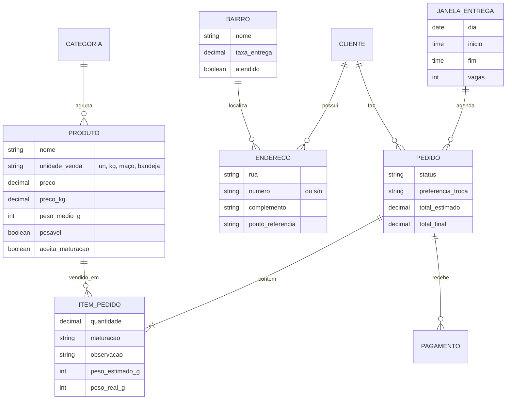

## Estrutura do repositório

```text
verdurao-piuminas/
├── assets/        # logo original e recortes com fundo transparente
├── design/        # arquivo do OpenPencil, exports das telas e fonte JSX
├── docs/          # imagens do README e tokens CSS
├── frontend/      # Angular 22            (a criar)
├── backend/       # API Java 25            (a criar)
└── infra/         # Nginx, systemd e backup (a criar)
```

## Como rodar localmente

> O código ainda não existe. Os comandos abaixo mostram como o projeto vai funcionar. Os do backend assumem Spring Boot + Maven, que são sugestões.

**Pré-requisitos:** JDK 25, Node.js 24 LTS, Angular CLI 22 e PostgreSQL 18 (instalado ou via Docker).

```bash
# 1. Banco de dados (opção com Docker)
docker run --name verdurao-db -e POSTGRES_USER=verdurao -e POSTGRES_PASSWORD=verdurao \
  -e POSTGRES_DB=verdurao -p 5432:5432 -d postgres:18

# 2. Backend: API em http://localhost:8080
cd backend
./mvnw spring-boot:run

# 3. Frontend: site em http://localhost:4200
cd frontend
npm install
npx ng serve --proxy-config proxy.conf.json
```

O `proxy.conf.json` do frontend manda as chamadas de `/api` para a API local:

```json
{ "/api": { "target": "http://localhost:8080", "secure": false } }
```

### Variáveis de ambiente da API

| Variável | Exemplo | Para quê |
|---|---|---|
| `DB_URL` | `jdbc:postgresql://localhost:5432/verdurao` | Conexão com o banco |
| `DB_USER` | `verdurao` | Usuário do banco |
| `DB_PASSWORD` | — | Senha do banco |
| `SERVER_PORT` | `8080` | Porta da API |
| `PAGAMENTO_TOKEN` | — | Credencial do gateway de pagamento |
| `WHATSAPP_TOKEN` | — | Token da WhatsApp Business API |

> Nunca coloque senhas e tokens no repositório. Em produção, eles ficam em `/etc/verdurao/api.env`, com permissão restrita.

## Deploy no Ubuntu Server

Passo a passo para um servidor **Ubuntu Server 26.04 LTS** (por exemplo, uma VPS com 2 vCPU e 8 GB, que aguenta o movimento do verão). Troque `seudominio.com.br` pelo domínio real, registrado no CNPJ do Verdurão.

**1. Pacotes e firewall**

```bash
sudo apt update && sudo apt upgrade -y
sudo apt install -y openjdk-25-jre-headless postgresql nginx certbot python3-certbot-nginx
sudo ufw allow OpenSSH && sudo ufw allow 'Nginx Full' && sudo ufw enable
```

**2. Banco de dados**

```bash
sudo -u postgres psql -c "CREATE ROLE verdurao WITH LOGIN PASSWORD 'troque-esta-senha';"
sudo -u postgres psql -c "CREATE DATABASE verdurao OWNER verdurao;"
```

**3. API Java como serviço**

```bash
sudo useradd --system --home /opt/verdurao --shell /usr/sbin/nologin verdurao
sudo install -d -o verdurao -g verdurao /opt/verdurao/api
sudo install -d -m 750 /etc/verdurao
# copie o .jar gerado pelo build para /opt/verdurao/api/verdurao-api.jar
# e crie /etc/verdurao/api.env com as variáveis de ambiente (chmod 600)
```

<details>
<summary><b>/etc/systemd/system/verdurao-api.service</b></summary>

```ini
[Unit]
Description=Verdurao Piuminas - API
After=network.target postgresql.service

[Service]
User=verdurao
EnvironmentFile=/etc/verdurao/api.env
ExecStart=/usr/bin/java -Xms256m -Xmx768m -jar /opt/verdurao/api/verdurao-api.jar
Restart=on-failure
SuccessExitStatus=143

[Install]
WantedBy=multi-user.target
```

```bash
sudo systemctl daemon-reload
sudo systemctl enable --now verdurao-api
journalctl -u verdurao-api -f   # acompanhar os logs
```

</details>

**4. Frontend e Nginx**

```bash
# na sua máquina: gere o build de produção
cd frontend && npx ng build
# no servidor: publique o conteúdo de dist/verdurao-piuminas/browser/ em /var/www/verdurao
```

<details>
<summary><b>/etc/nginx/sites-available/verdurao</b></summary>

```nginx
server {
    listen 80;
    server_name seudominio.com.br www.seudominio.com.br;

    root /var/www/verdurao;
    index index.html;

    location /api/ {
        proxy_pass http://127.0.0.1:8080;
        proxy_set_header Host $host;
        proxy_set_header X-Real-IP $remote_addr;
        proxy_set_header X-Forwarded-For $proxy_add_x_forwarded_for;
        proxy_set_header X-Forwarded-Proto $scheme;
    }

    location / {
        try_files $uri $uri/ /index.html;
    }
}
```

```bash
sudo ln -s /etc/nginx/sites-available/verdurao /etc/nginx/sites-enabled/
sudo nginx -t && sudo systemctl reload nginx
```

</details>

**5. HTTPS gratuito**

```bash
sudo certbot --nginx -d seudominio.com.br -d www.seudominio.com.br
```

**6. Backup diário do banco**

```bash
sudo install -d -o postgres -g postgres -m 700 /var/backups/verdurao
echo "0 3 * * * postgres pg_dump -Fc verdurao > /var/backups/verdurao/verdurao-\$(date +\%F).dump && find /var/backups/verdurao -name '*.dump' -mtime +14 -delete" \
  | sudo tee /etc/cron.d/verdurao-backup
```

> Guarde também uma cópia fora do servidor. O backup que só existe na própria VPS se perde junto com ela.

## Decisões em aberto

**Integração com o banco.** As quatro opções mais comuns em Java, todas compatíveis com PostgreSQL:

| Opção | Como funciona | Combina com | Atenção |
|---|---|---|---|
| **Spring Data JPA** (Hibernate) | Classes mapeadas como entidades e repositórios prontos | Cadastro e consulta simples (produtos, pedidos), quando a prioridade é produtividade | Consultas pesadas e o problema N+1 exigem cuidado |
| **JdbcClient** (Spring JDBC) | SQL escrito à mão, com mapeamento simples para objetos | Controle total do SQL e menos "mágica" | Mais código repetitivo |
| **jOOQ** | SQL com checagem de tipos, gerado a partir do banco | Relatórios e consultas complexas | Depende de gerar código a partir do esquema |
| **MyBatis** | SQL em XML ou anotações, mapeado para objetos | Quem prefere o SQL separado do Java | Mais configuração |

Sugestão para começar: **Spring Data JPA + Flyway** para o dia a dia, e **JdbcClient** para relatórios específicos.

Outras pendências:
- **Login do cliente:** e-mail e senha, código pelo WhatsApp ou os dois.
- **Gateway de pagamento:** comparar as taxas de Pix e cartão antes da integração.
- **Política do peso:** o que fazer quando o peso real passa do estimado (por exemplo, tolerância de até 10%).
- **Bairros e taxas reais:** confirmar a lista de bairros atendidos, as taxas e os horários com o Verdurão.

## Roadmap

- [x] Pesquisa de UX e benchmark
- [x] Design system e telas mobile (9) e web (10)
- [ ] Definir a integração com o banco e criar o modelo de dados
- [ ] API: catálogo, carrinho, bairros e janelas de entrega, pedidos
- [ ] Frontend Angular mobile-first
- [ ] Painel administrativo (produtos, preços, pedidos, bairros e taxas): telas a desenhar
- [ ] Pagamento com Pix e cartão
- [ ] Avisos de pedido pelo WhatsApp
- [ ] Deploy no Ubuntu Server com HTTPS e backup

## Documentação

| | Documento | Conteúdo |
|:-:|---|---|
| 📐 | [Design](design/README.md) | Arquivo do OpenPencil, exports e fonte JSX das telas |
| 🎨 | [Tokens CSS](docs/tokens.css) | Cores e medidas do design system |

## Créditos

- Ícones: [Lucide](https://lucide.dev) (ISC) · Ilustrações provisórias: [Fluent Emoji](https://github.com/microsoft/fluentui-emoji) (MIT) · Fontes: [Fredoka](https://fonts.google.com/specimen/Fredoka) e [Nunito Sans](https://fonts.google.com/specimen/Nunito+Sans) (OFL)
- Design feito no [OpenPencil](https://github.com/open-pencil/open-pencil)

---

<div align="center">
<sub>Feito com 💚 para o Verdurão Piuminas · Piúma, Espírito Santo</sub>
</div>
